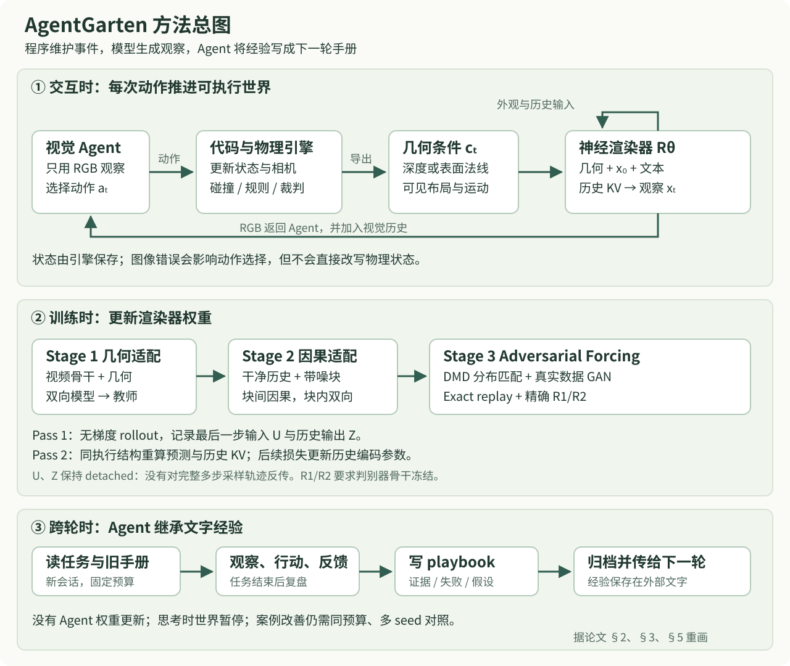

# AgentGarten 论文精读

阅读日期：2026-10-12

论文：**AgentGarten: Code Worlds for Evolving Agents**。MirroS 技术报告，作者来自 MirroS、清华大学与北京大学；arXiv v1 发表于 2026-10-08。本文讨论可编程交互环境、实时神经渲染，以及预训练 Agent 如何通过文字经验跨轮改进行为。

来源：[论文摘要](https://arxiv.org/abs/2610.12374v1)、[26 页 PDF](https://arxiv.org/pdf/2610.12374v1)、[HTML 全文](https://arxiv.org/html/2610.12374v1)、[项目演示](https://mirros-lab.github.io/agent-garten/)、[官方代码](https://github.com/MirroS-Lab/AgentGarten)、[渲染器权重](https://huggingface.co/MirroS-Lab/AgentGarten-renderer)。下文页码、图表编号以 PDF v1 为准，HTML 的图号存在差异。

相关周报：[2026-10-12 大模型周报中的 AgentGarten 条目](../../../llm_reports/read.html?report=2026-10-12.html#agentgarten)。

## 核心结论与阅读判断

AgentGarten 值得关注的主张是：**用程序维护世界的状态和规则，用共享视频模型生成外观，再让 Agent 把交互经验写成下一轮可继承的技能文件。** 这种分工让物理事件可检查、可回放，也允许同一状态轨迹更换视觉风格。

我的判断是，这篇论文最扎实的贡献集中在渲染器训练与数值执行：两遍计算恢复历史编码的梯度，逐块执行保证 replay 与采样一致，以及冻结判别器骨干条件下的精确 R1/R2。Agent 实验展示了有启发性的经验继承案例，但还不足以证明通用能力持续增长，也不能把摘要的“4 轮对比数百万次 RL”解释为同等条件下的效率倍数。[论文 §3–5，PDF p.5–15](https://arxiv.org/pdf/2610.12374v1)

| 问题 | 论文实际给出的证据 | 阅读结论 |
| --- | --- | --- |
| 世界状态能否独立于生成视频维护 | 引擎显式执行状态转移；生成帧只进入 Agent 的观察 | 架构上能隔离渲染误差对物理状态的直接污染 |
| 历史编码能否收到后续预测的梯度 | 两遍 replay、式 8 与公开实现 | 有清楚的计算路径，但没有完整反传全部采样过程 |
| replay 能否与采样一致 | 表 1：相对误差 3.99% 降为 bitwise 0 | 在报告的硬件、精度和执行结构下成立 |
| 长视频外观是否更好 | 图 8 的 30 秒定性对比 | 支持纹理改善，缺少量化质量与独立组件消融 |
| Agent 能否从经验中改善 | 表 4 的四个世界，每轮一个 episode | 是少量案例证据，不能当作多 seed 泛化统计 |
| 是否已有完整自动进化平台 | §7 明确讨论世界生成与经验扩展的未来工作 | 当前示范还未完成开放式世界生成与跨世界学习闭环 |

## 方法总图

图为根据论文 §2、§3、§5 重画的阅读示意，可点击放大。图中两种“学习”发生在不同对象上：视频渲染器更新权重；执行任务的 Agent 跨轮继承文字手册。不要把后者误读成在线 PPO、SFT 或权重蒸馏。

## 世界状态与视觉观察如何分工

### 程序负责状态转移

设场景程序为 $p$，状态为 $s_t$，相机位姿为 $\pi_t$，一个或多个 Agent 的动作是 $a_t$。引擎执行状态更新，并从当前相机输出几何条件：

$$
\begin{aligned}
(s_{t+1},\pi_{t+1})&=f_p(s_t,\pi_t,a_t),\\
c_t&=h_p(s_t,\pi_t).
\end{aligned}
$$

这里的状态包含物体位姿、关节和任务变量；条件 $c_t$ 是相机可见的深度或表面法线。神经渲染器根据历史帧、条件、参考外观 $x_0$ 与文本 $y$ 生成观察：

$$
x_t=R_\theta(x_{<t},c_{\leq t},x_0,y).
$$

Agent 看到 $x_t$ 后选择动作，动作再推进引擎。$f_p$ 不把生成图像作为物理状态输入，因此纹理漂移不会直接让引擎里的箱子消失、穿墙或改变碰撞规则；渲染错误仍可能让 Agent 看错并选错动作。[论文 §2.1，式 1–2，PDF p.3](https://arxiv.org/pdf/2610.12374v1)

**推论：状态一致与观察可信是两个验收问题。** 可执行状态能保证规则按代码运行，却不能保证生成图像准确表现了抓取、接触或遮挡。闭环评测应同时保留引擎事件与实际观察，分别检查“发生了什么”和“Agent 看到了什么”。

### 图像和文本如何变成世界

图像入口先提取实例分割、单目深度、相机内参、3D 包围盒及物体网格；coding agent 把资产放进场景，补齐未观察区域，并绑定物理属性与交互规则。文本入口直接编写几何原语和场景代码，再将初始渲染编辑为外观参考。两条路径都用探测相机、接触、碰撞余量和遮挡查询反复修正场景。[论文 §2.3，图 3，PDF p.3–4](https://arxiv.org/pdf/2610.12374v1)

未见区域是合理的场景扩展，不能据此声称恢复了真实房间。物理可信也依赖场景程序和引擎本身：程序写错或动力学过于简化时，神经渲染不会替它纠正。

### 深度和法线是便利接口，也有信息缺口

真实视频的条件由 ViPE、Depth Anything 3 和 NormalCrafter 等工具估计，模拟场景直接导出几何缓冲。法线以 $(n+1)/2$ 显示；深度按 Vision Banana 的非线性映射着色：

$$
u(d)=1-\left(1+\frac{\alpha d}{10}\right)^{-2}.
$$

有尺度深度取 $\alpha=1$；未知尺度时，以有效深度中位数 $m$ 设置 $\alpha=10(\sqrt{2}-1)/m$，让中位深度映射到 $u=0.5$。尺度在同一 clip 内共享。法线还必须统一相机坐标和朝向。[附录 A.2，式 14，PDF p.21–22](https://arxiv.org/pdf/2610.12374v1)

**信息论上的限制：** 深度和法线不确定颜色、材质和物体身份。轴对称物体自转时，几何缓冲可能不变，表面的标记却应旋转；只给几何和有限历史，渲染器无法总是辨别这种变化。细杆、窄缝和小幅接触变化也可能在下采样后丢失。论文 §7 将更完整的条件接口列为未来工作，而不是已解决问题。

## 渲染器的三阶段训练

### 骨干和几何 token

骨干来自 Cosmos 3-Nano。理解塔 UND 冻结，将文本编码为逐层 KV；生成塔 GEN 执行视频生成。学生、教师和 fake-score 网络共享 UND 的文本结果。Wan 视频自编码器冻结，压缩时间 4 倍、空间 16 倍。

几何视频先空间池化，再用同一视频编码器和 RGB 输入投影生成条件 token：

$$
G_t=W_{\mathrm{in}}\,\mathcal P\big([E(S(c))]_t\big)+e_{\mathrm{geo}}.
$$

$S$ 是空间池化，$E$ 是冻结编码器，$\mathcal P$ 是 latent patch 分组，$e_{\mathrm{geo}}$ 为零初始化的模态 embedding。几何与 RGB 在**序列维**拼接，共享 Transformer；文本通过交叉注意力接入，只有带噪 RGB token 输出速度预测。不同网格共享时间位置，并把空间 RoPE 坐标映射到同一图像范围。参考帧与条件不参与去噪。[论文 §3.1–3.2，式 3–4，PDF p.4–5](https://arxiv.org/pdf/2610.12374v1)

在 $480\times832$ 输出下，每个 latent 帧有 390 个 RGB token、28 个几何 token。这个设计减少了条件开销，但是否优于通道拼接或 ControlNet，本文没有提供定量架构消融。为减轻真实视频估计条件与引擎条件的差异，训练随机保留深度或法线，并做双模态 dropout、纹理抑制、平滑形变和 latent 噪声扰动。[附录 A.2](https://arxiv.org/pdf/2610.12374v1)

### 从双向模型改成块因果模型

第一阶段使模型学会跟随几何；第二阶段采用 parallel teacher forcing。每个目标块有干净副本 $P_j$ 和带噪副本 $Q_j$，参考前缀记为 $A_0$。箭头表示 query 可以读取的 token：

$$
\begin{aligned}
P_j&\longrightarrow A_0\cup P_{\leq j},\\
Q_j&\longrightarrow A_0\cup P_{<j}\cup Q_j.
\end{aligned}
$$

$Q_j$ 可以看历史干净块和自身带噪块，不能偷看自己的干净答案；块内双向、块间因果。这允许多个目标块在一次训练前向中并行计算，各自采样 flow time。对干净 latent $z_j$ 和高斯噪声 $\epsilon_j$：

$$
\begin{aligned}
z_{j,t_j}&=(1-t_j)z_j+t_j\epsilon_j,\\
\mathcal L_{\mathrm{TF}}&=\mathbb E\left[\frac1M\sum_{j=1}^M
\left\|v_\theta(z_{j,t_j},t_j\mid z_{<j},\mathcal C)-(\epsilon_j-z_j)\right\|_2^2\right].
\end{aligned}
$$

其中 $\mathcal C=(x_0,y,c)$，$M$ 是目标块数量。训练时历史是干净数据，推理时历史却由模型产生；第三阶段用学生自己的 rollout 缩小这项分布差异。[论文 §3.3，式 5–6，PDF p.5–6](https://arxiv.org/pdf/2610.12374v1)

### 三阶段配置与资源

| 阶段或网络 | 初始化 | 更新范围 | 学习率 |
| --- | --- | --- | --- |
| 几何适配 | Cosmos 3-Nano | self-attention 投影、q/k norm、条件 embedding | $3\times10^{-5}$ |
| 因果适配 | 第一阶段 | 同上 | $3\times10^{-5}$ |
| 蒸馏学生 | 第二阶段 | 完整视频流 | $2\times10^{-6}$ |
| fake-score | 第一阶段 | 完整视频流 | $4\times10^{-7}$ |
| 判别器 | 新初始化的 head，冻结教师骨干 | 仅 head | $2\times10^{-7}$ |

GEN 有 36 层，hidden width 4096，32 个 query head、8 个 KV head。各阶段报告使用 32 张 H100、FSDP、每卡一个 clip、累积两步，global batch 为 64 clips。第一、第二阶段先用 5 秒再用 15 秒窗口；16 fps 时间网格下对应 81 和 241 个像素帧。数据包含 DL3DV-10K、OpenDV、互联网游戏/导航/机器人视频和少量合成场景。**单卡实时推理不代表单卡就能按论文成本完成训练。** 附录没有给出足以重建数据混合与总成本的完整样本数量、训练步数或 GPU 小时。[附录 A.1，表 5，PDF p.21](https://arxiv.org/pdf/2610.12374v1)

## Adversarial Forcing 的分布匹配目标

第三阶段同时使用 DMD、可微历史 replay 和真实视频对抗监督。学生由因果适配模型初始化，自回归生成历史；冻结的双向第一阶段教师联合评估生成 clip。fake-score 网络学习学生分布，它不是 GAN 判别器。

对学生预测 $\widetilde z_\theta$ 加噪得到 $y_\tau=(1-\tau)\widetilde z_\theta+\tau\epsilon$。教师与 fake-score 的 clean estimate 分别为 $f_T$、$f_\psi$，定义：

$$
\begin{aligned}
g&=\frac{f_\psi(y_\tau,\tau\mid\mathcal C)-f_T(y_\tau,\tau\mid\mathcal C)}{a},\\
\mathcal L_{\mathrm{DMD}}&=\mathbb E\left[\frac1{2N}\left\|
\widetilde z_\theta-\operatorname{sg}(\widetilde z_\theta-g)
\right\|_2^2\right],\\
a&=\max\left\{\operatorname{mean}\left(\left|\widetilde z_\theta-f_T(y_\tau,\tau\mid\mathcal C)\right|\right),10^{-5}\right\}.
\end{aligned}
$$

$N$ 为 latent 元素数，$a$ 为逐视频归一化，$\operatorname{sg}$ 表示 stop-gradient。[论文式 7，附录式 16，PDF p.6、22](https://arxiv.org/pdf/2610.12374v1)

**推导其优化含义：** 把括号里的 target 看成固定值，则平方误差的残差就是 $g$，所以对学生预测的梯度为 $g/N$，并不会反向穿过教师、fake-score 或 target 中的学生副本。这是把分布匹配方向包装成可用普通反传的 surrogate；loss 数值下降不等于逐帧复原真实视频的误差下降。

fake-score 在 detached 学生样本上用 flow matching 更新，每次学生更新配五次 fake-score 更新；教师 CFG scale 为 6。四步采样的完整端点为 $(1600/1601,15/16,5/6,5/8,0)$。学生目标和归一化使用第二遍 replay 的预测，第一遍的录制输出只提供历史上下文。[附录 A.4，式 15–16](https://arxiv.org/pdf/2610.12374v1)

## Exact replay 到底恢复了哪条梯度

### detached KV cache 为什么会漏掉历史监督

标准 Self Forcing 把已经生成的块编码成 detached KV。后续损失可以更新“如何读取这个 KV 并预测当前块”，却无法通过这份 cache 更新“怎样把历史图像编码成 KV”。如果让完整多步、自回归 rollout 全部保留计算图，显存又很昂贵。

AgentGarten 分两遍执行：第一遍不建梯度图，记录每个块最后一次去噪的输入 $U_j$ 与干净输出 $Z_j$；第二遍重新编码已录制的历史，并重算最后一步：

$$
\widetilde z_{\theta,j}=\operatorname{sg}(U_j)-t^*v_\theta\left(
\operatorname{sg}(U_j),t^*\mid\operatorname{sg}(Z_{<j}),\mathcal C;\mathcal M_{\mathrm{TF}}\right).
$$

历史图像 $Z_{<j}$ 本身 detached，但第二遍的 history encoder 参数仍在图内。因此后续损失能沿着“当前输出 → 历史 KV → 历史编码参数”回传。[论文 §3.4.2，式 8，PDF p.6–7](https://arxiv.org/pdf/2610.12374v1)

一个简化的链式求导有助于区分：设重新计算的历史 KV 为 $K_\theta(Z)$、$V_\theta(Z)$，当前预测为 $F_\theta(U,K,V)$，那么

$$
\frac{dF}{d\theta}=\left.\frac{\partial F}{\partial\theta}\right|_{K,V}
+\frac{\partial F}{\partial K}\frac{\partial K_\theta(Z)}{\partial\theta}
+\frac{\partial F}{\partial V}\frac{\partial V_\theta(Z)}{\partial\theta}.
$$

后两项就是 cache detach 时丢失的路径；因为 $Z$ 固定，这里不包含 $\partial Z/\partial\theta$。**恢复历史编码梯度不等于对全部历史生成、多步采样轨迹做完整 BPTT。**

### 为什么同一个 attention mask 还不够

SGF 风格 replay 用一次 full-sequence FlexAttention，而 rollout 使用逐块 cache。实数运算下相同 mask 可以表达相同函数；BF16 下，kernel、张量形状、矩阵分组与归约顺序变化会产生舍入差异，并被深层网络放大。

论文的 exact replay 逐块使用 SDPA，对齐可见上下文、KV 顺序、调用形状、投影与 FFN 分组。历史 KV 在第二遍重新计算，不能直接拿第一遍 detached cache 顶替。每块实际包含 noisy query 和 clean publication 两次 attention 调用。[论文图 5、附录 A.4](https://arxiv.org/pdf/2610.12374v1)

| 表 1 指标 | SGF 风格 FlexAttention | 逐块 SDPA replay |
| --- | --- | --- |
| rollout 与 replay 的相对 $L_2$ 误差 | 3.99% | 0，bitwise 一致 |
| replay 前向时间 | 2.95 s | 2.79 s |
| 峰值 allocated memory | 50.83 GiB | 50.92 GiB |

测试使用一张 H100、36 层、$480\times832$、61 个 latent 帧、BF16；时间是三次预热运行的中位数，**不包含 backward 和 optimizer**。表中前向下降 5.4%，显存增加约 0.2%。这是受控执行差异的证据；不能把 bitwise 一致扩展为所有硬件、kernel 版本和并行设置下的普遍保证，也不能直接说完整训练快了 5.4%。[表 1，PDF p.9](https://arxiv.org/pdf/2610.12374v1)

## 对抗监督与精确 R1/R2 推导

### 为什么在 DMD 之外加真实数据监督

DMD 使用教师与 fake-score 对生成样本的估计；对抗项直接比较真实和生成视频。判别器 $D_\phi(x)=h_\phi(B(x))$ 使用冻结教师骨干 $B$ 的第 11、23、35 层特征，以及可训练聚合 head $h_\phi$。真实和生成 clip 在同条件、同噪声、同 timestep 下得到 logits $r,f$：

$$
\begin{aligned}
\mathcal L_G&=\mathbb E[\operatorname{softplus}(\operatorname{sg}(r)-f)],\\
\mathcal L_{\mathrm{rel}}&=\mathbb E[\operatorname{softplus}(f-r)],\\
\mathcal L_{\mathrm{student}}&=\mathcal L_{\mathrm{DMD}}+\lambda_G\mathcal L_G.
\end{aligned}
$$

生成器更新推动 fake logit 超过 real；判别器更新推动 real 超过 fake。生成器端的对抗梯度通过线性 surrogate 注入 replay，避免保留整段 rollout 的图。[论文 §3.4.3，式 9，附录 A.4](https://arxiv.org/pdf/2610.12374v1)

### 冻结骨干为何能绕过 attention double backward

R1/R2 是真实/生成输入上的判别器输入梯度平方。通常要对输入梯度再求参数梯度，融合 attention 的 backward 未必支持再次求导。论文利用 **$B$ 冻结、只训练 $h_\phi$** 的条件，改用 VJP 与 JVP。

对单个样本，令 $z=B(x)$、$A=J_B(x)$、$u=\nabla_z h_\phi(z)$。先反向计算输入梯度，再前向传播这个方向：

$$
\begin{aligned}
g&=A^\top u=\nabla_x D_\phi(x),\\
R&=g^\top g=u^\top AA^\top u,\\
v&=Ag=AA^\top u.
\end{aligned}
$$

因为 $z,A$ 与 head 参数 $\phi$ 无关，逐步求导得到：

$$
\begin{aligned}
\nabla_\phi R
&=2\left(\frac{\partial u}{\partial\phi}\right)^\top AA^\top u\\
&=2\left(\frac{\partial u}{\partial\phi}\right)^\top v\\
&=\nabla_\phi\left[2J_z h_\phi(z)\operatorname{sg}(v)\right].
\end{aligned}
$$

把方向在当前参数处计算后 detach，令 $s=2J_z h_\phi(z)\operatorname{sg}(v)$，构造：

$$
\widetilde R=\operatorname{sg}(g^\top g)+s-\operatorname{sg}(s).
$$

前向时 $s-\operatorname{sg}(s)=0$，因此值是原始 penalty；反向只走 $s$，因此 head 的一阶参数梯度与真正的 $R$ 一致。对真实和 detached 生成样本分别计算即可得到 R1/R2。判别器目标为

$$
\mathcal L_D=\lambda_D\left(\mathcal L_{\mathrm{rel}}+\frac\gamma2(\widetilde R_1+\widetilde R_2)\right).
$$

**适用边界：** 骨干可以非线性，但必须冻结；每次更新都要重新计算方向；该 surrogate 不提供任意高阶导数的替代图。head 的混合二阶导数在数学上仍存在，绕过的是大型融合 attention 的 backward-over-backward。[论文式 10–13，附录 B，PDF p.7–8、22–23](https://arxiv.org/pdf/2610.12374v1)

公开代码还值得注意：当前 [`exact_regularization.py`](https://github.com/MirroS-Lab/AgentGarten/blob/06bb4621deb9b380c34abb6dac42fe0b31eec2e3/wm/models/exact_regularization.py) 用冻结骨干的 forward-mode JVP，再用 `autograd.grad(..., create_graph=True)` 计算小 head 的梯度；这与论文描述的显式 head 方向导数实现路径有差别，但同样把 double backward 限制在 head 上。不能笼统写成“完全不需要二阶导数”。

## 实时推理和长期缓存

服务端保留 reference 与 sink prefix，加上最近历史的滑动窗口。默认配置为 5 个 sink latent 帧、44 个 recent latent 帧，每次生成 4 个 latent 帧，对应 16 个像素帧。旧帧的 RGB 与几何 KV 同时淘汰。超过训练长度时，当前块 RoPE 起点限制为 $\min(s,H-b)$，recent history 移到它前面并重新旋转 key；condition 内容仍按实际模拟时间索引。[论文 §3.5、附录 C，PDF p.8、23](https://arxiv.org/pdf/2610.12374v1)

推理组合了手写 Triton 融合算子、cuBLAS、CUDA graph 与 tiny decoder，减少短块执行的访存和 kernel launch 开销。表 2 的测量条件是单 H100、BF16 主计算、FP16 tiny decoder、四步去噪、$480\times832$、cache 已填满。

| 每个 16 帧块 | 时间 |
| --- | --- |
| 条件编码 | 10.6 ms |
| Transformer 四步去噪与 cache publication | 414.4 ms |
| tiny decoder 与 host transfer | 8.8 ms |
| 总 wall time | 438.8 ms |
| 渲染吞吐 | 36.5 frames/s |

阶段时间是 GPU 中位数，总时间是 wall-time 均值，包含阶段外工作，因此三个数不必精确相加等于总时间。稳态统计覆盖两个 769 帧 rollout 的第 17–48 块。[表 2，PDF p.9](https://arxiv.org/pdf/2610.12374v1)

**计算解读：** $16/0.4388\approx36.46$ fps，与表中吞吐吻合；其每块生产速度快于 16 fps 时间网格的一秒内容，但整个块耗时约 439 ms。这个吞吐不含完整 Agent 思考、动作 RPC、网络和浏览器显示链路，不能倒推出每 27 ms 都有一次新决策。附录的 task file 明确让世界在思考期间暂停，动作批次内也没有新的决策机会。它验证了按块提供交互观察的能力，尚未验证持续运行世界中的严格反应时限。

## Agent 如何通过 playbook 改进

实践轮开始时，Agent 获得 task file，知道目标、动作接口与预算；随后观察神经生成 RGB，执行动作，结束后写下尝试、观察、失败、不确定性和下一步。下一轮用新会话启动，读取原任务与此前手册。捉迷藏两方各自维护一课一个文件的技能库，文件可以含代码。[论文 §5.2–5.3，PDF p.11、13–14](https://arxiv.org/pdf/2610.12374v1)

因此经验保存在外部文本，而非 Agent 权重更新。论文参考文献 [32] 将预训练 Agent 指向 GPT-6 Astra；这还不足以完整恢复模型服务版本、推理预算、系统提示和工具包装。coding agent 创建世界与 acting agent 在世界里执行任务也应区分。

### 捉迷藏的轮数比较

该实验采用顺序执行的一名 hider 和一名 seeker：hider 先布置，再交给 seeker。角色用第一人称神经观察和短 Python 动作程序，不接收物体坐标、隐藏状态或对手私有观察；每轮有五局，使用采样布局和 seed，初始手册为空。

| 策略里程碑 | 历史从零 self-play RL | 预训练视觉 Agent |
| --- | --- | --- |
| 建造掩体 | 约 2500 万 training episodes | 第 4 轮 |
| 使用斜坡进入掩体 | 约 1 亿 training episodes | 第 10 轮 |

轮与 episode 不是同一单位。按每轮五局，只能说到第 4/10 轮分别经历了约 20/50 局的轮级预算，不能据此确定首次出现策略的精确 episode，更不能计算可信的效率倍数。两边还不同在预训练知识、观测、动作粒度和顺序博弈变体。论文正文已明确提醒：这是两种学习范式的里程碑参照。[表 3 与 §5.2，PDF p.11、14](https://arxiv.org/pdf/2610.12374v1)

### 四个额外世界的完整结果

| 世界与指标 | 第 1 轮 | 第 2 轮 | 第 3 轮 | 第 4 轮 |
| --- | --- | --- | --- | --- |
| 伴侣犬 engagement score | 13 | 14 | 19 | 19 |
| 狭桥双方到达所用秒数，越低越好 | 71 | 68 | 45 | 41 |
| 牧羊 score，满分 100 | 60 | 90.1 | 87.6 | 88.3 |
| 牧羊入栏数量，共 4 只 | 3 | 4 | 4 | 4 |
| 采石场装载机 score，满分 100 | 30 | 0 | 30 | 90.9 |

表 4 明确每个世界每轮仅一个 episode。狭桥始终成功，到达时间改善；牧羊后三轮全数入栏，但得分没有持续上升；装载机第二轮退化为 0，第四轮在 360 秒限制内用 329 秒完成清场、送石与停车。应保留中间失败，不能只用首尾分数概括为稳定单调进化。[表 4，PDF p.15](https://arxiv.org/pdf/2610.12374v1)

另一个口径差异是：正文 §5.4 概括这些 Agent 都使用第一人称观察，但附录 D 装载机 task file 明确使用跟随位置、固定世界朝向的高位第三人称相机，图 12 也呈现该视角。稳妥结论是“均以视觉观察交互”，装载机的观察设定应单独说明。[附录 D，PDF p.26](https://arxiv.org/pdf/2610.12374v1)

## 证据强度与适用范围

### 哪些结论还需要对照实验

1. **playbook 的因果收益。** 当前结果缺少同模型、同 seed、同预算的无手册、通用反思和打乱手册对照。改善可能同时来自经验继承、布局变化或生成随机性。
2. **Adversarial Forcing 各组件的贡献。** 图 8 对比的是组合方法和 Self Forcing，无法分别确定历史梯度、精确执行和 GAN 对画质的增益。还需要量化几何跟随、身份保持、遮挡后恢复和长时漂移。
3. **神经外观对任务的价值。** 需要固定状态轨迹比较常规 RGB、神经 RGB 与诊断几何条件。更漂亮的画面可能帮助预训练视觉模型，也可能遮蔽关键接触信息。
4. **跨世界泛化。** 已展示的手册属于各自世界；未见世界成功率、长期知识检索、错误经验清除和自动课程增长还没有构成统计性证据。

这些是基于论文实验设计的研究判断，不是作者已报告的负结果。本文有可运行方向与案例价值，但整体证据更接近系统技术报告，不能读成完整的通用 Agent 学习 benchmark。

### 适合迁移的场景

适合状态可以显式编程、视觉主要由几何决定、动作容许按块执行的环境，例如布局导航、工具使用和多 Agent 协作原型。同一状态轨迹换风格特别适合做视觉鲁棒性实验。精确 replay 也适用于其他依赖自生成历史 KV 的自回归视频蒸馏；R1/R2 推导则适用于冻结大骨干、训练小判别 head 的架构。

对高速反馈控制、细接触操作、必须识别材质/身份/自转的任务，当前几何接口和动作节奏都有明显限制。狭桥 task file 允许车辆原地转向，明确是简化控制；装载机使用低速有限力转弯。这些合成任务的成绩不能直接转成真实车辆或机器人能力证据。[附录 D，PDF p.24–26](https://arxiv.org/pdf/2610.12374v1)

## 公开实现与复现入口

截至 2026-10-12，官方仓库已提供渲染器训练、streaming inference、服务算子与 checkpoint；README 仍将完整实时服务/前端、code worlds 与 Agent practice loop 列为待发布。Hugging Face 模型清单可见 `student.safetensors`、`und.safetensors`、配置与 tokenizer，不能据此宣称完整论文交互系统已开源。[官方 README](https://github.com/MirroS-Lab/AgentGarten)、[模型清单](https://huggingface.co/api/models/MirroS-Lab/AgentGarten-renderer)

本次代码核对版本为 `06bb4621deb9b380c34abb6dac42fe0b31eec2e3`；权重仓库清单 revision 为 `fb956aab255f8c263e29040265c072054d402ea0`。这里只核查公开文件与实现，没有执行 GPU 复现实验。

| 需要理解的模块 | 固定版本代码入口 |
| --- | --- |
| 四步端点、DMD、GAN 与更新调度 | [wm/models/dmd.py](https://github.com/MirroS-Lab/AgentGarten/blob/06bb4621deb9b380c34abb6dac42fe0b31eec2e3/wm/models/dmd.py) |
| penalty 数值与 head gradient surrogate | [wm/models/exact_regularization.py](https://github.com/MirroS-Lab/AgentGarten/blob/06bb4621deb9b380c34abb6dac42fe0b31eec2e3/wm/models/exact_regularization.py) |
| 分组前向与 replay 计算 | [wm/networks/cosmos3/network.py](https://github.com/MirroS-Lab/AgentGarten/blob/06bb4621deb9b380c34abb6dac42fe0b31eec2e3/wm/networks/cosmos3/network.py) |
| sink、window 与 RoPE 策略 | [wm/networks/cosmos3/streaming.py](https://github.com/MirroS-Lab/AgentGarten/blob/06bb4621deb9b380c34abb6dac42fe0b31eec2e3/wm/networks/cosmos3/streaming.py) |
| 精确 penalty 的训练配置 | [wm/configs/experiments/cosmos3/dmd_gan_exact.py](https://github.com/MirroS-Lab/AgentGarten/blob/06bb4621deb9b380c34abb6dac42fe0b31eec2e3/wm/configs/experiments/cosmos3/dmd_gan_exact.py) |

**复现时应显式选配置。** 通用 `dmd_gan.py` 默认使用有限差分 regularization；`dmd_gan_exact.py` 才设置 `regularization="exact"`，权重为 0.075，并关闭 real-score 的 compile。当前 exact 路径还明确拒绝 context parallelism。公开配置与论文最佳方案并非可以互换的名称。

优先从 checkpoint 的固定条件短视频渲染、cache 长度和 replay 误差检查入手，再评估长轨迹与 tiny decoder。完整重训还需要几何标注数据、冻结教师和 fake-score 的初始化，以及论文未完整公布的数据混合；不要从单卡演示直接跳到 32 卡训练。

## 对现有游戏 Agent 实验的启发

以下是研究建议，不属于论文结果；本次未启动新实验，也不改变当前项目优先级。

对推箱子等可执行规则明确的环境，最先值得借鉴的是 **验证经验继承是否提高未见关卡成功率**。这不需要先接入昂贵的神经渲染。现有模拟器已经可以提供状态裁判和 RGB 观察，把视觉链路稳定下来之后，再分别研究记忆和外观变化。

| 最小实验 | 冻结的比较条件 | 回答的问题 |
| --- | --- | --- |
| 无手册 / 通用反思 / 经验手册 / 打乱手册 | 同底模、held-out 关卡、动作接口、观察、token 与动作预算；每局新会话 | 收益是否来自可迁移经验，而非多尝试或提示长度 |
| 验证手册 / 未验证手册 | 仅训练布局可用于实践与经验验证；测试布局不写回记忆 | 错误经验传播是否限制跨轮改进 |
| 原始 RGB / 改变外观 RGB | 固定引擎状态、动作、相机和评测关卡 | 视觉先验与外观干扰各占多少 |
| 固定动作轨迹的多外观回放 | 完全相同底层事件，比较动作识别与闭环测试 | 区分观察变化与动力学变化 |

主指标应是未见关卡通关率、死锁率、有效动作数和预算耗尽率，并保存引擎事件与实际截图；文字手册可以提出假设，但须通过重放或多布局验证才进入长期技能库。静态动作标签准确率只能描述局部预测，不能替代闭环成绩。若这些低成本实验显示稳定收益，再考虑神经渲染与自动生成世界。

## 复习时应能回答的问题

- 引擎 $f_p$ 与渲染器 $R_\theta$ 分别保存什么？渲染误差为何仍会影响成功率？
- $Q_j$ 为什么不能读取自己的 $P_j$？teacher forcing 到自生成历史的差异在哪里？
- exact replay 为什么既要重算 KV，又要匹配 kernel、分组和调用形状？
- $Z$ 被 stop-gradient 后，还能训练哪一部分历史处理？丢掉的是哪条梯度？
- R1/R2 推导为什么依赖冻结骨干？为什么“绕过 attention double backward”不等于没有 head 二阶导数？
- 36.5 fps、439 ms/block、16 fps 模拟网格各自是什么量？思考暂停如何影响解释？
- 第 4/10 轮策略出现和表 4 的单 episode 结果，分别能支持什么、还不能支持什么？

阅读结论：优先吸收可执行环境、可验证经验和计算路径一致性的设计。渲染器提供了具体可复用的技术；Agent 持续进化的广泛主张仍需要同预算对照、多 seed、未见世界与长期记忆实验来验证。
