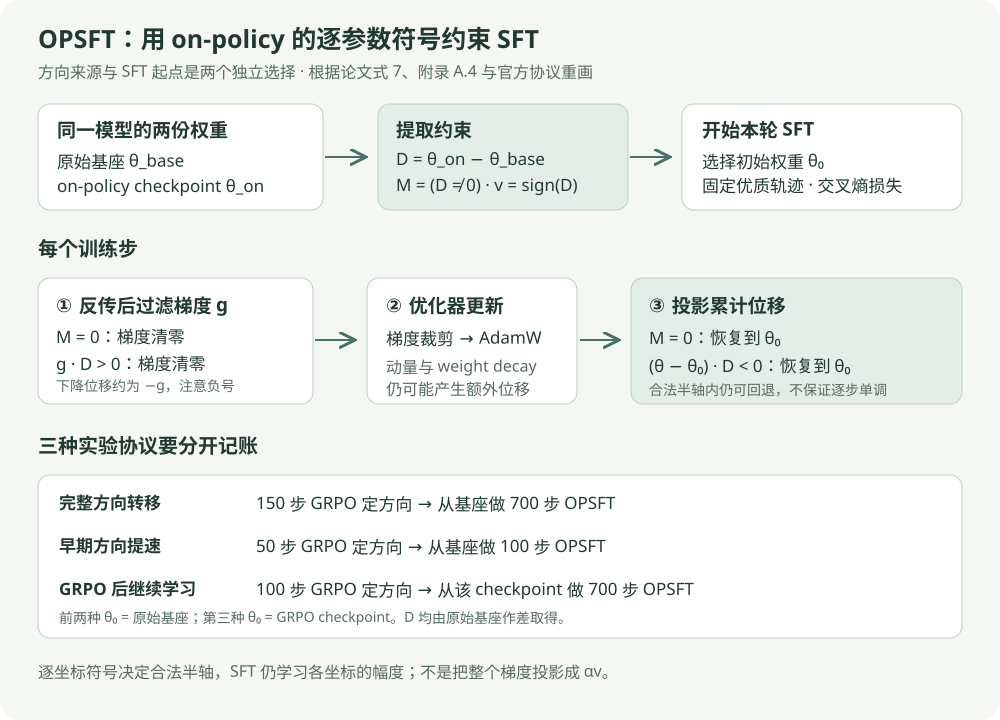

# OPSFT 论文精读

阅读日期：2026-10-13

论文：**On-Policy Parameter Update Direction Underlies Generalization in LLM Post-Training**，Shufan Shen 等，作者来自中科院计算所、国科大与美团。arXiv v1 发表于 2026-09-29，共 18 页。研究问题是：能否把 on-policy 训练留下的参数更新规律，直接用作 SFT 的优化约束，从而转移其泛化收益？

来源：[摘要与版本记录](https://arxiv.org/abs/2609.36659)、[v1 PDF](https://arxiv.org/pdf/2609.36659v1)、[HTML 全文](https://arxiv.org/html/2609.36659v1)、[官方代码](https://github.com/ssfgunner/OPSFT)。公式、图表和页码以 PDF v1 为准。代码解读对应 2026-10-13 核对的提交 [`5460fe1`](https://github.com/ssfgunner/OPSFT/tree/5460fe13056bd826b03aaf989f03bebf8b32ad48)。

相关周报：[2026-10-12 大模型周报中的 OPSFT 条目](../../../llm_reports/2026-10-12.html#opsft)。相关基础：[DPO](DPO.md)、[Pair-GRPO](pair-grpo-family.md)、[混合精度](../infra/混合精度.md)。

## 核心结论与研究判断

**论文最有价值的结果是：在相同教师轨迹上，保留 on-policy 训练识别出的逐参数更新位置与正负号，能让 SFT 的数学与代码泛化明显改善。** 它把一部分 on-policy 训练的产物变成可复用的优化约束；损失函数仍是交叉熵，后续训练不必持续在线采样。

我的判断是，OPSFT 值得作为“已有 RL 或 OPD checkpoint 后，继续吸收优质示范”的基线。实验比单纯的参数相关性分析更进一步，因为作者实际干预了 SFT 的更新规则，并加入位置约束和随机符号对照。不过，这支持的是**方向信息具有可迁移的作用**，尚不足以证明它是所有 on-policy 泛化优势的唯一或必要原因。理论部分给出了梯度结构的解释，没有证明测试误差界，也没有证明 SFT 的方向必然固定。[论文 §3–4、附录 C](https://arxiv.org/pdf/2609.36659v1)

| 核心问题 | 证据 | 可以得出的结论 |
| --- | --- | --- |
| 方向信息是否比位置更有用 | 表 A13：on-policy 位置 34.07，随机符号 27.71，真实符号 41.15 | 在该 Qwen3-4B 数学设置中，正确符号有实质作用 |
| 少量 on-policy 训练是否足够定方向 | 表 2：50 步 GRPO 定方向，再从基座做 100 步 OPSFT | 可缩短报告中的整段训练时间，仍需支付定方向成本 |
| 能否继续训练 RL 模型 | 表 3：Qwen3-8B 从 40.31，经普通 SFT 到 37.50，经 OPSFT 到 42.39 | 该阶段可减轻能力退化并提升均分 |
| 是否能通用跨域复用方向 | 图 4：DAPO→DeepMath 有效，代码 Eurus→数学效果弱 | 同域复用有证据，任意跨域复用没有依据 |
| 是否已解释所有泛化机制 | 只有有限模型、任务、轨迹与固定 seed | 应视作有干预证据的机制候选与优化方法 |

这里“方向”主要指每个参数增加、减少或保持不动的符号。它与整层更新向量的余弦方向不同，也不是沿一个固定向量作一维投影。

## 方法流程与三种使用方式

图为根据论文式 7、附录 A.4 与官方使用说明重画。需要区分两种初始权重：提取方向的参照是原始基座；OPSFT 硬约束的参照是这一轮 SFT 开始前的权重。两者在继续学习实验里不同。

| 协议 | 如何取得方向 | OPSFT 从哪里开始 | 目的 |
| --- | --- | --- | --- |
| 完整方向转移，图 3 / 表 A10–A12 | 完整 on-policy 阶段；官方主复现使用 150 步 GRPO | 原始基座 | 检验方向是否能转移泛化收益 |
| 早期方向提速，表 2 / 表 4 | 50 步 GRPO | 原始基座，再做 100 步 OPSFT | 减少持续 rollout 的需求 |
| GRPO 后继续学习，表 3 / 表 5 | 原始基座到 100 步 GRPO checkpoint 的差分 | 该 GRPO checkpoint，再做 700 步 OPSFT | 用新优质轨迹继续提升 |

**提速协议中的 50 步 GRPO 用来提取约束，OPSFT 并非直接接着 GRPO 权重训练。** 官方 `application_efficiency.md` 的 `MODEL_PATH` 指向基座；继续学习协议才指向 GRPO checkpoint。忽略这一点会把方向约束收益和已经获得的 RL 权重收益混在一起。[官方效率协议](https://github.com/ssfgunner/OPSFT/blob/5460fe13056bd826b03aaf989f03bebf8b32ad48/docs/application_efficiency.md)、[继续学习协议](https://github.com/ssfgunner/OPSFT/blob/5460fe13056bd826b03aaf989f03bebf8b32ad48/docs/application_continual_posttraining.md)

## 梯度分析与它的证明边界

### 为什么当前策略下的 score 期望为零

给定 prompt $x$、完整响应轨迹 $\tau$ 和参数 $\theta\in\mathbb R^d$，定义 score 向量：

$$
s_\theta(x,\tau)=\nabla_\theta\log\pi_\theta(\tau\mid x).
$$

在分布归一化、可交换求和与求导等常规条件下：

$$
\begin{aligned}
\mathbb E_{\tau\sim\pi_\theta}[s_\theta(x,\tau)]
&=\sum_\tau\pi_\theta(\tau\mid x)\nabla_\theta\log\pi_\theta(\tau\mid x)\\
&=\sum_\tau\nabla_\theta\pi_\theta(\tau\mid x)\\
&=\nabla_\theta\sum_\tau\pi_\theta(\tau\mid x)\\
&=\nabla_\theta 1=0.
\end{aligned}
$$

第一步展开期望；第二步使用对数导数；最后一步来自概率和为 1。这是当前策略采样下的恒等式，不能直接用于固定教师分布采样。[论文式 1–2，p.3](https://arxiv.org/pdf/2609.36659v1)

### on-policy 梯度是优势与 score 的协方差

使用轨迹优势 $A_\theta(x,\tau)$，理想化的策略目标上升方向为：

$$
g_{\mathrm{on}}=\mathbb E_x\mathbb E_{\tau\sim\pi_\theta}[A_\theta(x,\tau)s_\theta(x,\tau)].
$$

对一个标量优势和一个向量 score，条件协方差本身是向量；论文文字称其为 covariance matrix 时，应按下面的对象理解：

$$
\begin{aligned}
\operatorname{Cov}(A_\theta,s_\theta\mid x)
&=\mathbb E[A_\theta s_\theta\mid x]
-\mathbb E[A_\theta\mid x]\mathbb E[s_\theta\mid x]\\
&=\mathbb E[A_\theta s_\theta\mid x],\\
g_{\mathrm{on}}&=\mathbb E_x[\operatorname{Cov}(A_\theta,s_\theta\mid x)].
\end{aligned}
$$

因此对任意固定符号向量 $v$，$v^\top g_{\mathrm{on}}$ 是该协方差沿 $v$ 的分量。直观上，某个参数应往哪边走，取决于“该参数提高哪些当前响应的概率”是否与“这些响应获得的优势”一致。策略改变后，采样到的响应、优势和 score 都会变化。[论文式 3–5，p.3–4](https://arxiv.org/pdf/2609.36659v1)

此处的符号需要注意：$g_{\mathrm{on}}$ 是策略目标的上升方向，而下一节的 $g$ 是 SFT 损失的下降前梯度，实际位移近似为 $-g$。完整 GRPO 还涉及组内归一化、概率比与裁剪等，以上表达用于解释更新结构，不能代替完整实现。

### 固定教师数据不意味着 SFT 梯度恒定

固定教师分布 $q(\tau\mid x)$ 下，SFT 最小化交叉熵：

$$
\begin{aligned}
L_{\mathrm{SFT}}(\theta)&=-\mathbb E_x\mathbb E_{\tau\sim q}[\log\pi_\theta(\tau\mid x)],\\
\nabla_\theta L_{\mathrm{SFT}}&=-\mathbb E_x\mathbb E_{\tau\sim q}[s_\theta(x,\tau)].
\end{aligned}
$$

教师轨迹分布固定，但 $s_\theta$ 仍随参数变化。故这些公式只解释了两类训练的驱动力不同，**不能单独推出 SFT 的更新符号必然不变，或 on-policy 的方向必然近似正交**。论文图 2 在 Qwen3-1.7B / DeepMath 上给出观察：SFT 区间更新正相关，累计方向余弦接近 1；OPD / GRPO 区间更新更接近正交，累计相关约 0.5。它是该实验下的数值现象。[论文式 6、图 2，p.4](https://arxiv.org/pdf/2609.36659v1)

还有一个推理跳跃：动态方向探索之后，作者选取最终累计符号作为约束。动态调整有助于提出这个假设；最终符号能否保留泛化收益，真正由 OPSFT 干预实验回答。

## OPSFT 的两级约束

### 从 checkpoint 差分提取支持集与符号

设原始基座为 $\theta_{\mathrm{base}}$，on-policy checkpoint 为 $\theta_{\mathrm{on}}$：

$$
\begin{aligned}
D&=\theta_{\mathrm{on}}-\theta_{\mathrm{base}},\\
M_i&=\mathbf 1[D_i\ne0],\\
v_i&=\operatorname{sign}(D_i)\in\{-1,0,1\}.
\end{aligned}
$$

$M$ 决定哪些坐标允许学习，$v$ 决定这些坐标允许朝哪个半轴移动。官方主复现采用 exact nonzero support，差分精确为零的坐标被禁止更新。提取脚本也支持 top-k 和 threshold，但它们是不同的选择规则，不能默认为论文 exact-support 配置。[方向提取代码](https://github.com/ssfgunner/OPSFT/blob/5460fe13056bd826b03aaf989f03bebf8b32ad48/scripts/analyze_update_mask.py)

这个“非零”依赖 checkpoint 的实际存储精度。把 BF16 checkpoint 转成 FP32 后相减，不会恢复保存前已被舍入掉的微小更新；跨精度比较时必须同时记录训练主权重与保存精度。

### 第一层在反传后过滤梯度

令 $g=\nabla L_{\mathrm{SFT}}$。论文式 7 保留与 $v$ 同号的下降位移：

$$
g_{s,i}=\mathbf 1[\operatorname{sign}(-g_i)=v_i]\,g_i.
$$

官方伪代码先把 $M_i=0$ 的梯度置零，再屏蔽 $g_iD_i>0$ 的坐标。原因是梯度下降沿 $-g_i$ 走；若 $D_i>0$，只有负梯度才会推动参数增加。零梯度保留与否不改变结果。[式 7、附录 A.4，p.4、14](https://arxiv.org/pdf/2609.36659v1)

以 $v=(+1,-1,0)$、$g=(-2,-3,5)$ 为例，过滤后 $g_s=(-2,0,0)$，SGD 位移为 $(2\eta,0,0)$。第二个坐标的普通 SFT 位移为正，与所需负方向冲突；第三个坐标不在支持集中。

### 第二层在 optimizer step 后投影累计位移

AdamW 的动量和解耦权重衰减可能绕过“当前梯度置零”。因此官方代码在更新后检查参数。设 $\theta_0$ 是**本轮 SFT 的初始权重**，$\tilde\theta$ 是 optimizer step 的临时结果，则：

$$
\theta_{t+1,i}=\begin{cases}
\theta_{0,i},&M_i=0,\\
\theta_{0,i},&M_i=1\ \text{且}\ (\tilde\theta_i-\theta_{0,i})D_i<0,\\
\tilde\theta_i,&\text{其他情况}.
\end{cases}
$$

这把参数限制到以 $\theta_0$ 为顶点的逐坐标符号锥：

$$
\mathcal C=\{\theta:\theta_i=\theta_{0,i}\ \text{若}\ M_i=0;\quad
v_i(\theta_i-\theta_{0,i})\ge0\ \text{若}\ M_i=1\}.
$$

**这里约束的是相对初始权重的累计位移，不是每一步实际位移都必须同号。** 一个正方向坐标可以从 $\theta_0+0.2$ 回到 $\theta_0+0.1$，仍在合法半轴内。新梯度有方向过滤，但优化器状态可能使一步位移回退；硬投影只阻止它跨过初始点。核对的代码对违规坐标恢复参数，没有同时清空该坐标的动量状态。[官方 trainer 的梯度过滤与参数约束](https://github.com/ssfgunner/OPSFT/blob/5460fe13056bd826b03aaf989f03bebf8b32ad48/verl/verl/trainer/fsdp_sft_trainer.py#L460)

从几何上看，这是高维正交象限约束，允许各参数独立选择幅度；它不是把梯度替换成 $\alpha v$。因此逐参数符号固定，并不妨碍整层更新向量的余弦方向随训练改变，也不要求最终幅度复制 GRPO。这个区别解释了图 6 的矩阵级方向变化。

## 数据 模型与评测口径

| 项目 | 论文设置 |
| --- | --- |
| 学生模型 | Qwen3-1.7B / 4B / 8B；DeepSeek-R1-Distill-Llama-8B |
| 数学 RL prompt | DeepMath 难度 ≥6，约 57K；跨数据方向实验另用 DAPO |
| 代码 RL prompt | Eurus-RL-Code，约 25K |
| SFT 教师 | Qwen3-30B-A3B-Instruct-2507，每个 prompt 采样一次 |
| 教师采样 | temperature 0.6，top-p 0.95，最多 16,384 个新 token |
| 数据筛选 | 数学通过 Math-Verify；代码有 Python code block 且执行测试通过 |
| 数学 SFT 数据 | 44,810 条训练；另列 914 条 examples，原文此处省略其角色，官方路径为 validation |
| 代码 SFT 数据 | 9,585 条训练 |
| 默认 SFT / OPSFT | 8 张 NVIDIA H20，FSDP2，FP32 参数，batch 64，长度 16,384，700 步 |
| 优化器 | AdamW，β₁=0.9、β₂=0.95，weight decay 0.01，clip norm 1.0；恒定 LR、无 warmup，seed 42 |
| 学习率 | 通常 1e-7；效率实验 1e-6 |
| GRPO | prompt batch 128，每题 rollout 8，LR 1e-6，KL 系数 0；数学响应长度 16,384，代码 8,192 |
| 数学评测 | AIME24 / AIME25 / HMMT25-Feb / HMMT25-Nov，每题采样 8 个回答 |
| 代码评测 | HumanEval+ / MBPP+ / LiveCodeBench v6（2025-02 至 2025-05），每题采样 4 个回答 |
| 评测生成 | temperature 1.0，top-p 1.0，最多 16,384 token；报告平均正确率 |

数据与设置来自[附录 A.1–A.3，p.13–14](https://arxiv.org/pdf/2609.36659v1)。附录将数学表写作 Acc@8，正文又说明平均正确率，应按“8 次采样的平均准确率”阅读，**不能解释成 8 次中任意一次成功即算成功的 pass@8**。表中 Mean 为 benchmark 分数的算术平均，不是合并全部题目的加权准确率。

对比 SFT 与 OPSFT 时使用相同固定教师数据，因此这组对照能隔离约束的作用；GRPO 同时改变了采样分布、奖励和训练过程，不能把三者当成仅优化器不同的等价数据预算。多次回答采样也不等于多个训练 seed。

## 实验结果与证据强度

### 真实符号优于位置约束和随机符号

表 A13 的 Qwen3-4B / DeepMath 实验如下，四项 Mean 都是数学 benchmark 均分：

| 更新位置 | 更新符号 | Mean |
| --- | --- | --- |
| 随机 | 不约束 | 30.84 |
| on-policy | 不约束 | 34.07 |
| on-policy | 随机 | 27.71 |
| on-policy | on-policy | 41.15 |

只找到“更新哪些参数”不够；随机给这些坐标方向反而变差。真实符号相对位置约束提高 7.08 个百分点，支持信息来自具体的 on-policy 方向，而非任意梯度屏蔽都能得到同样收益。不过，随机符号与真实符号未必保留相同梯度量、位移范数和有效步数；要进一步排除普通正则化效应，还需更严格的幅度与预算匹配。[表 A13，p.17](https://arxiv.org/pdf/2609.36659v1)

完整训练轨迹还揭示了学习速度与最终分数的区别：表 A12 中 Qwen3-8B 在 100 步时普通 SFT 为 34.30，方向 OPSFT 为 21.25；到 700 步则为 38.41 与 42.81。不能根据完整方向实验声称 OPSFT 每个训练阶段都收敛更快。

OPD 也有验证：Qwen3-1.7B 的 Mean 为普通 SFT 13.83、仅位置 13.48、方向 OPSFT 16.71、OPD 16.75。它说明方向来源不局限于 GRPO，但 OPD 证据仅这一模型与数学设置。[表 A9、A12，p.15、17](https://arxiv.org/pdf/2609.36659v1)

### 早期方向方案的精度与时间

下面对应表 2，预算是 GRPO 100 步、普通 SFT / DFT 700 步、50 步 GRPO 提取方向加 100 步 OPSFT。OPSFT 时间包含方向识别阶段。

| 模型 | SFT Mean / 时间 | GRPO Mean / 时间 | OPSFT Mean / 时间 | 相对 GRPO 的耗时减少 |
| --- | --- | --- | --- | --- |
| Qwen3-1.7B | 13.15 / 3.5h | 12.09 / 4.9h | 15.11 / 2.3h | 53.1% |
| Qwen3-4B | 34.22 / 8.1h | 38.96 / 16.5h | 40.11 / 6.4h | 61.2% |
| Qwen3-8B | 38.41 / 13.2h | 40.31 / 19.3h | 41.67 / 8.9h | 53.9% |
| R1-Distill-Llama-8B | 18.02 / 13.6h | 25.21 / 18.2h | 26.56 / 8.1h | 55.5% |

耗时减少由 $1-T_{\mathrm{OPSFT}}/T_{\mathrm{GRPO}}$ 计算。Qwen3-8B 对 GRPO 的均分增益为 1.36 个百分点，对普通 SFT 为 3.26 个百分点；并非每个单项都领先，其 AIME25 为 42.92，低于 GRPO 的 44.58。Qwen3-1.7B 在该表中普通 SFT 本来就比 GRPO 高，不能把“SFT 一定弱于 RL”当作前提。[表 2、§4.1，p.7](https://arxiv.org/pdf/2609.36659v1)

这是特定训练协议下的整段墙钟收益：不同方法更新次数、rollout 数和样本暴露量不同；减少的是持续采样需求与达到所报分数所需的训练时间，**没有证明相同步数下 OPSFT 单步计算快两倍**。论文时间表没有单列教师轨迹生产、数据筛选与评测成本；新建流水线时不能把训练时间当成完整端到端成本。

代码实验也有相同趋势：Qwen3-4B / Eurus 的三 benchmark 均分为 GRPO 57.19（20.3h）、SFT 54.30（9.8h）、OPSFT 58.07（9.5h）。OPSFT 对 GRPO 省时约 53.2%，对 SFT 仅约 3.1%；且 MBPP+ 的 67.30 低于 GRPO 69.04。[表 4，p.8](https://arxiv.org/pdf/2609.36659v1)

### 已有 GRPO 模型继续学习

表 3 从 100 步 GRPO checkpoint 出发，再用教师轨迹训练 700 步。此处复用的 $D$ 是原始基座到 GRPO checkpoint 的差分，硬投影的 $\theta_0$ 则是 GRPO checkpoint：

| 模型 | GRPO 后 Mean | 再做普通 SFT | 再做 OPSFT |
| --- | --- | --- | --- |
| Qwen3-1.7B | 12.09 | 13.54 | 16.77 |
| Qwen3-4B | 38.96 | 36.25 | 41.36 |
| Qwen3-8B | 40.31 | 37.50 | 42.39 |
| R1-Distill-Llama-8B | 25.21 | 16.36 | 26.15 |

普通 SFT 在 4B、8B 和 R1-Distill 上退化，1.7B 仍提升；因此“再 SFT 必然破坏 RL 能力”也过强。OPSFT 在四个均分上都提高，但并不保住每个单项：Qwen3-4B 的 AIME25 从 45.31 到 44.17。结论应是该设置改善了平均表现与继续学习稳定性，不能保证所有能力不退化。[表 3，p.7](https://arxiv.org/pdf/2609.36659v1)

表 5 的代码继续学习结果为 57.19→48.71（SFT）与 57.19→60.05（OPSFT）。这是一轮追加训练的证据；多轮增量数据、域切换和方向重新识别是否需要，仍需实验。

### 域外评测与方向跨域复用是不同问题

DeepMath 训练后，表 1 在 IFEval、ARC、HaluEval、HellaSwag、WinoGrande、PIQA 上测得：

| 模型 | Base | SFT | GRPO | OPSFT |
| --- | --- | --- | --- | --- |
| Qwen3-4B 六项均分 | 73.43 | 73.65 | 73.95 | 74.11 |
| Qwen3-8B 六项均分 | 75.85 | 75.54 | 76.20 | 76.39 |

OPSFT 比 SFT 分别高 0.46、0.85 个百分点，比 GRPO 高 0.16、0.19；没有报告对应置信区间，不能夸大这些小差异。六项也不是逐项获胜：4B 的 HellaSwag 为 52.22，略低于 SFT 的 52.41。[表 1，p.5](https://arxiv.org/pdf/2609.36659v1)

图 4 则问“在另一数据上识别出的方向，能否约束当前任务训练”：DAPO 与 DeepMath 的位置重叠约 0.4、符号方向余弦约 0.2，尽管方向不相同，DAPO 的方向用于 DeepMath 仍有效；代码 Eurus 的方向用于 DeepMath 较弱。**数学训练后域外能力保持，并不意味着数学方向适合任意跨域训练。**

### 精度会改变看起来有多少参数在学习

表 6 在 Qwen3-8B 上报告“实际参数发生变化”的比例：

| 参数精度与方法 | 变化参数占比 | 数学 Mean |
| --- | --- | --- |
| FP32 GRPO | 9.499% | 42.01 |
| BF16 SFT | 2.702% | 38.33 |
| BF16 OPSFT | 0.408% | 40.94 |
| FP32 SFT | 89.286% | 38.41 |
| FP32 OPSFT | 9.454% | 42.81 |

BF16 会舍入小位移，所以“只动 0.408% 参数”同时受约束和数值精度影响。论文所写相对基座“24.59% improvement”，由 40.94−16.35 得到，应读作 **24.59 个百分点**；若算相对增幅则约 150.4%。它也不等价于只需要为 0.408% 参数保存优化器状态：公开实现仍采用完整模型训练和约束张量，未给出与这个比例相称的显存节省。[表 6、§4.3，p.8](https://arxiv.org/pdf/2609.36659v1)

谱分析图 A8 显示 OPSFT 更新的 stable rank、奇异值分布和主方向旋转更接近 GRPO；图 7 显示类似响应长度和部分推理提示词频率。它们是辅助机制观察，不能把更高输出方差或更多逻辑连接词直接等同于更强推理能力。

## 可复现入口与实现要点

官方仓库已经提供[教师验证轨迹](https://huggingface.co/datasets/shufanshen/SFT-Trajectories)、匹配的 [4B DeepMath 150 步 checkpoint](https://huggingface.co/shufanshen/Qwen3-4B-GRPO-DeepMath-150-steps) 与[模型集合](https://huggingface.co/collections/shufanshen/opsft-6aa781ffb646c53df3707a3b)。第一轮验证可以复用这些资产，检验 SFT 与 OPSFT 的差别；节约的是本轮重复采样与教师数据生成成本，方向本身仍来自已有 on-policy 训练。

复现顺序为：冻结基座与 checkpoint 的 revision → 提取 exact support / 差分 → 从同一初始模型跑 SFT、location-only、direction 三组 → 同一评测生成配置比较均分和单项。提速与继续学习使用不同 checkpoint 和初始模型，须按上面的协议表执行。

| 代码入口 | 实际负责什么 |
| --- | --- |
| `run_extract_subspace.sh` 与 `scripts/analyze_update_mask.py` | 加载匹配权重，保存 `update_mask.pt`、`parameter_updates.pt` 和统计 |
| `run_sft.sh` | 配置初始模型、数据、SFT_VARIANT、精度、步数与评测 |
| `verl/verl/trainer/fsdp_sft_trainer.py` | 加载分片 mask / 差分，反传后过滤梯度，更新后恢复违规参数 |
| `docs/application_efficiency.md` | 50 步方向识别与 100 步 OPSFT 的提速协议 |
| `docs/application_continual_posttraining.md` | 从 GRPO checkpoint 继续训练的协议 |

[官方完整使用说明](https://github.com/ssfgunner/OPSFT/blob/5460fe13056bd826b03aaf989f03bebf8b32ad48/README.md)

实现时最容易出错的是梯度下降的负号、两种初始权重、优化器状态，以及分片张量与 mask 的对齐。还应记录每层允许坐标比例、过滤前后梯度范数、实际位移范数、更新后违规坐标数和精度。exact-support 检测里极小变化也会算作非零，checkpoint 存储变化可能影响整个约束。

公开提取脚本在 CPU 上同时加载两份 FP32 模型，并拼接全模型绝对差分；8B 的两个权重本体就约 64 GB，尚未计入差分、拼接副本和框架开销。训练还保留本轮初始权重和约束信息，不能把“多一个简单 mask”误读为几乎零内存成本。大模型应先评估共享路径上的内存峰值，再考虑按层流式提取。

## 局限与进一步实验

论文最明确的适用前提是**强教师生成并通过验证的优质轨迹**。附录 C.2 承认尚未系统处理轨迹质量、多样性与学生适配性；OPSFT 不能替代恢复轨迹、失败状态覆盖或高质量监督。

从机制判断看，现有证据还有四个边界。第一，固定 seed 42 与有限模型不能建立普适结论，小幅 OOD 差异需要多 seed 与置信区间。第二，符号依赖参数坐标、模型结构和精度，未证明可以跨模型直接搬用。第三，同号约束没有幅度上界，沿合法方向走太远仍可能损害能力。第四，成功轨迹上的收益不自动覆盖有噪声、负样本、多模态或长程交互设置。

复现优先级建议如下；这是基于论文证据提出的后续实验，尚未执行：

| 优先级 | 实验 | 想排除的替代解释 |
| --- | --- | --- |
| 1 | 相同初始模型、轨迹、LR 和更新次数，SFT / location / true sign / random sign，至少 3 个训练 seed | 单次随机性与任意 mask 正则化 |
| 2 | 匹配每层支持集、过滤梯度量和位移范数；加 SFT 自身差分符号作方向来源 | 收益是否只来自更小步长或通用训练符号 |
| 3 | 按 GRPO 10 / 25 / 50 / 100 / 150 步提取方向，画累计 GPU 小时与质量曲线 | 50 步是否适合当前任务，方向何时值得冻结 |
| 4 | 分别测试强教师、弱教师、噪声与恢复轨迹；固定最终评测集 | 数据质量是否决定 OPSFT 还能否有效 |
| 5 | 多轮追加数据、方向刷新、幅度或 KL 约束，记录逐任务退化 | 一轮继续学习收益是否能持续 |

若迁移到当前推箱子多轮 SFT，第一步应先补齐恢复示范与独立地图评测，再讨论从同一模型的 on-policy 阶段提取方向。论文验证的是全参数坐标，LoRA 的 A/B 因子有重参数化自由，A/B 符号并不等价于合并权重差分的符号；不能把 full-weight OPSFT 直接改成 LoRA 梯度符号过滤后声称同方法复现。

## 阅读总结

OPSFT 提供了一个值得检验的后训练分工：on-policy 阶段识别有用的更新坐标与符号，SFT 阶段用优质轨迹在允许的符号区域里学习更新幅度。其最扎实的证据是同数据下的真实符号干预，以及已有 GRPO checkpoint 后的继续学习收益。

对实际项目，先复用已有方向资产做同预算对照，比立即新跑大规模 RL 更容易判断收益。保留三个判断标准：看独立任务结果而非训练 loss；把方向识别、数据生产与训练成本分开记账；同时报告逐任务退化与均分提升。标题提出的是机制主张，当前结果最稳妥地落在“方向可转移部分泛化收益”这一层。
